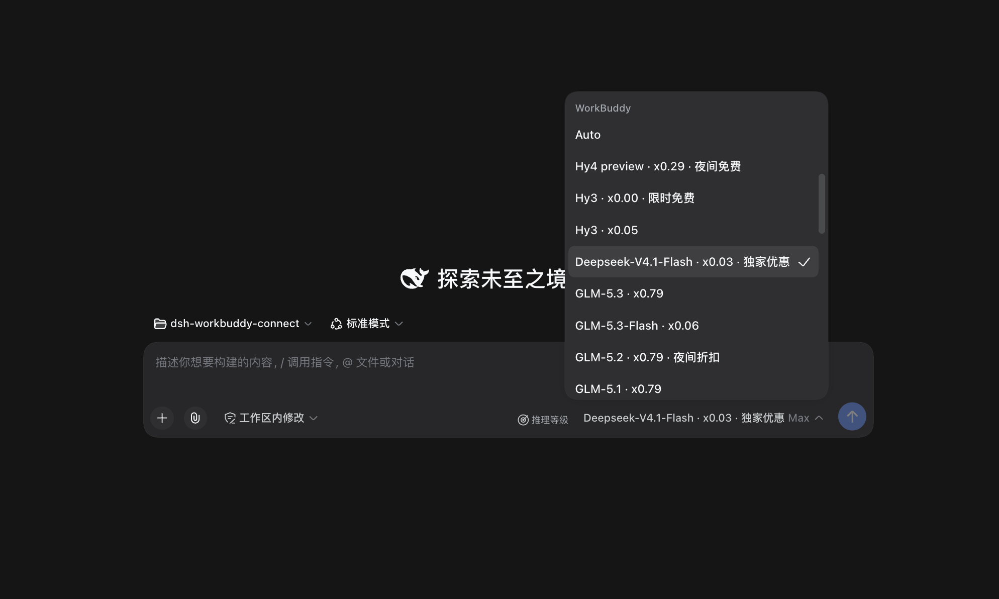
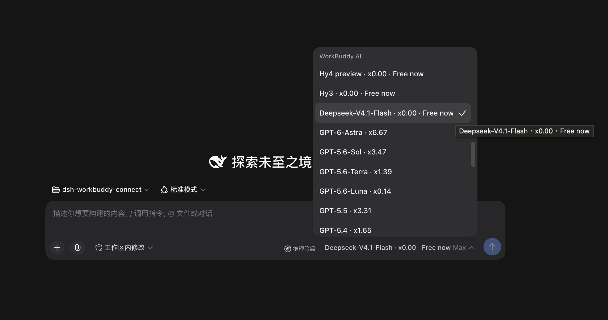
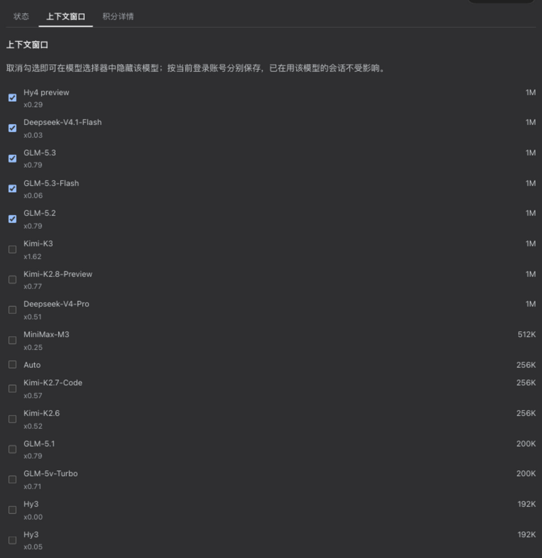
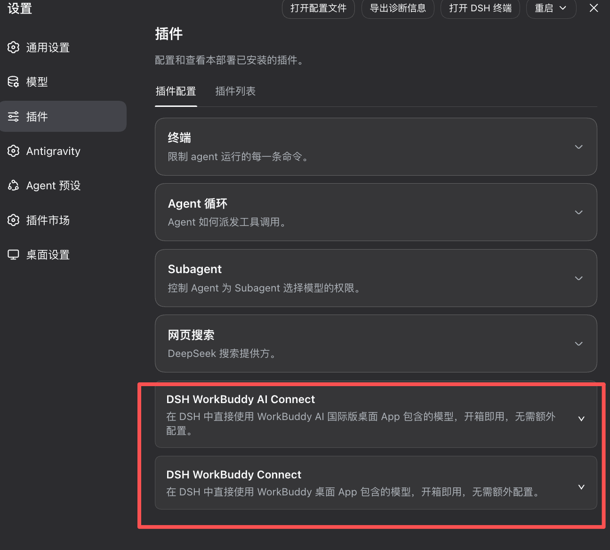
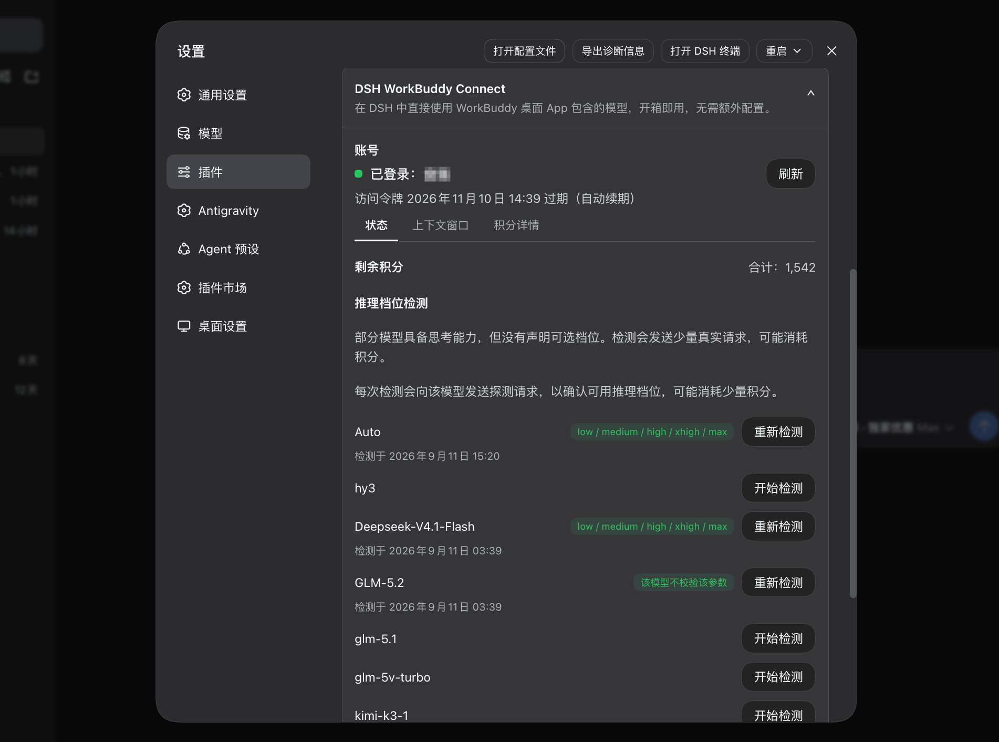
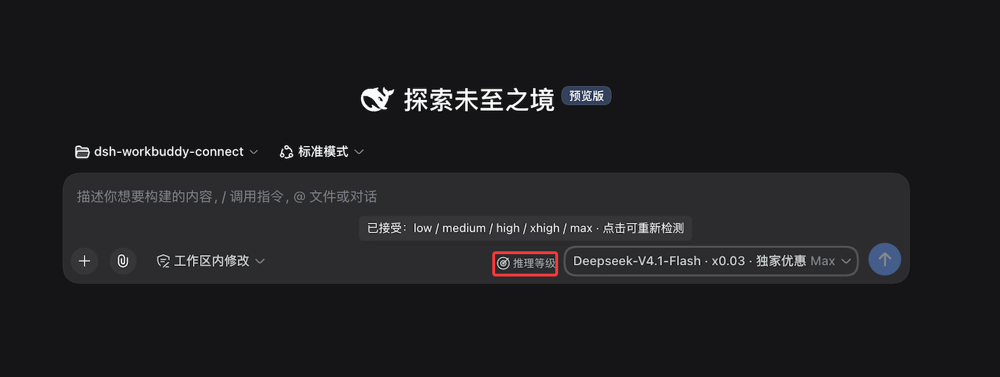

# DSH WorkBuddy Connect

English | [中文](./README.md)

Brings the models available in your signed-in WorkBuddy / WorkBuddy AI desktop app into [DeepSeek Harness](https://github.com/deepseek-ai/deepseek-harness); the two versions each show their own model group and reuse their own account sign-in and credit.

> [!WARNING]
> **The current version no longer supports WorkBuddy AI (international).** This project now supports only the CN WorkBuddy desktop app: the `workbuddy-ai` provider, the "WorkBuddy AI" group in the model picker, and its settings card are no longer maintained and are not guaranteed to work. The international notes kept below — install steps, `--provider workbuddy-ai`, `WORKBUDDY_AI_*` variables — are historical; do not configure against them. The CN WorkBuddy setup is unaffected.

## Install

**Prerequisite**: the WorkBuddy (CN) or WorkBuddy AI desktop app is installed and signed in on this machine. The plugin reuses the app's sign-in state and follows account switches automatically; the two never affect each other.

**Recommended: let an Agent you already have do the install** — any assistant with terminal and file access (the DSH agent, Codex, Claude Code, Cursor, …). Paste this to it verbatim:

```text
Please install and verify the DSH (DeepSeek Harness) plugin @cwentor/dsh-workbuddy-connect for me (project: https://github.com/Cwentor/dsh-workbuddy-connect).
Start by reading the project README and confirming which interface I actually use (Web / Desktop / TUI) and its DSH core version — for the Desktop app, the bundled core, never the standalone CLI's version.
Then install from the official npm package per the version mapping (0.2.1-rc.2 -> 0.8.0), preferring a locally supported non-market channel; on some Desktop distributions (the official Electron app in particular) the profile is app-managed and rules vary by distribution — check mine first, then explore its compliant install route, but never bypass its validation.
Ask for my consent and make backups before changing any local files or configuration.
After installing, verify the WorkBuddy group appears in the model picker and walk me through one short conversation.
If the Desktop install still fails generation validation (e.g. the @types/retry false positive), report it honestly, reference upstream dataelement/dsh-desktop#688, and suggest switching to the standalone Web / TUI — do not modify dependency packages or bypass the check.
```

Core-to-plugin quick reference:

| DSH core | Plugin |
|---|---|
| 0.2.1-rc.2 | 0.8.0 |

<details>
<summary>Manual install (command line, Web / TUI only)</summary>

```sh
# Web (this build supports the 0.2.1-rc.2 core; or install from source via github:Cwentor/dsh-workbuddy-connect)
dsh plugin --profile web add @cwentor/dsh-workbuddy-connect@0.8.0
dsh web

# TUI (same 0.8.0; that profile needs pnpm 11, e.g. npx pnpm@11)
dsh plugin --profile dsh-tui add @cwentor/dsh-workbuddy-connect@0.8.0
dsh --profile dsh-tui
```

</details>

> **TUI version pairing**: the terminal shell `@deepseek-harness-tui/dsh-tui` must be 0.10.0-beta.5 or newer — older versions fail at startup with this plugin installed (`events is not iterable`); manual reasoning-level detection exists on Web / Desktop only, not TUI.

> **Desktop**: on some Desktop distributions (the official Electron app in particular) the `desktop` profile is app-managed, and the official app rejects the standalone CLI's `--profile desktop`; other distributions may follow different rules, so check yours first and do not blindly use the standalone CLI's `--profile desktop`. An Agent may probe whether your distribution offers a compliant non-market install route, but that is not guaranteed to work; never blindly edit the app-managed directory or bypass its validation.

**Verify**: after restarting the interface, the model picker shows the "WorkBuddy / WorkBuddy AI" group(s) (with only one app installed, check just that group), and a model picked from the group completes one short conversation with a normal reply — that is what a successful install means.

## Features

- **Works out of the box**: install and enable the plugin, then use it directly in DSH — no extra configuration.



- **CN and international side by side**: the CN app appears as the WorkBuddy group and the international one (WorkBuddy AI) as the WorkBuddy AI group; their models, accounts, and credit never mix. Each group follows only its own app's sign-in — install just the international app and only WorkBuddy AI appears, install both and both groups appear, sign out of one and that group goes away. Settings shows one card per version, each with its own account and balance.



- **Image input**: most models accept images pasted or dropped straight into the conversation (GLM-5.3-Flash, the DeepSeek-V4 series, and more); the few text-only models (e.g. GLM-5.1 / GLM-5.2 on the China endpoint) clearly say so.

- **Reasoning levels**: levels explicitly declared by WorkBuddy appear directly — for example, GLM-5.3 and GLM-5.3-Flash offer low / high / max. For models without declared levels, Web and Desktop offer a manual check in the model picker (it sends a few requests and may consume credit); models without a check result or selectable levels keep using WorkBuddy's default.

- **Balance at a glance**: with a WorkBuddy / WorkBuddy AI model selected, the composer shows the account's remaining credit next to the model selector (e.g. `WB.3,401 credits`, `WB AI.3,401 credits` on the international app). Credit is not polled automatically (every status read is a real billing query): one read on mount, then refresh on demand with the ↻ before the balance. During session switching, the controls may briefly hide until the model selection is ready, then return automatically. The refresh button remains available even when the model has no reasoning-level detection entry or the balance cannot be read.

- **Status and detection**: the card in the left-sidebar Plugins panel (workbuddy-connect → View) shows the account, token validity, remaining credit, and model offers; it also refreshes the model list manually, shows whether the current list came from the upstream or the built-in fallback, and runs manual reasoning-level detection for eligible models. The Settings → Models page shows no WorkBuddy entries, by design.

- **Model visibility**: the Context window tab of each card lets you check which models appear in the model picker. Hidden lists are saved per signed-in account: switching accounts switches to that account's own list, switching back restores it; new accounts and newly added models are visible by default. Hiding only affects pickability — existing chats using a hidden model keep working.



- **Enterprise credit**: on the CN product, enterprise accounts (non-empty `enterpriseId`) read their cycle quota from the enterprise billing endpoint, and the card shows the enterprise quota with the cycle reset time.

- **Rate**: every model name carries its credits multiplier (e.g. `GLM-5.2 · x0.79`, `Hy3 · x0.00`) in both the `/model` popup and the composer's model dropdown; the rate is display-only and never affects requests.

- **Promo badges**: promo badges (limited-time free, night discount) ride the model name itself (e.g. `Hy4 preview · x0.00 · 限时免费`), visible wherever you pick a model, and the status card collects currently discounted models — per WorkBuddy service data, synced each time DSH starts. The international version's promotions come from the service's `modelPromotions` (with an effective window); once a promotion lapses its badge is withdrawn, and because the service writes the discounted value into the model's own rate field, the original price cannot be reconstructed — the model then reports "price unavailable — refresh to update" instead of repeating the discounted rate or claiming it is free.



The expanded card has three tabs: Status shows the account, token validity, total credit, catalog source, and reasoning-level detection; Context lists each model's context window, and the international version's "use the upstream's largest declared context window" switch lives here (on by default, so DSH sizes context compression to the largest declared window; turn it off to follow the upstream default instead, and the preference persists across restarts); Details shows per-package credit and model offers. The CN and international versions each get their own card.



## Why reasoning levels work this way

Information about WorkBuddy models' reasoning levels is currently split between upstream API responses and private UI logic in the client, while the model catalog changes quickly. If the plugin filled in one uniform set of levels for every model without an upstream declaration, it would need to keep chasing unpublished product logic with no stable contract.



Testing also found that some models accept the `reasoning_effort` parameter while ignoring unknown values and falling back to their default behavior. A successful request alone therefore does not prove that a level is actually usable.

For models without declared levels, Web and Desktop instead use user-authorized, on-demand detection: it first confirms that the upstream validates the parameter, then checks which standard levels it accepts. The check sends a few requests and may consume credit. Its result means only that the upstream currently accepts that level; it does not promise a particular change in reasoning quality, speed, or credit use.

## CLI

`dsh plugin --profile <web|dsh-tui> exec @cwentor/dsh-workbuddy-connect status`: sign-in state and remaining credit (`--json` for machine-readable output; `doctor` for diagnostics and `logout` for credential cleanup are also available). The `desktop` profile is generally managed by the desktop app, so the CLI (including `exec`) does not work against it (see the Desktop note under Install).

Both commands target the CN version by default; add `--provider workbuddy-ai` for the international one:

```sh
dsh plugin --profile web exec @cwentor/dsh-workbuddy-connect status --provider workbuddy-ai
dsh plugin --profile web exec @cwentor/dsh-workbuddy-connect doctor --provider workbuddy-ai
```

`logout` removes only that version's plugin-owned credential copy. It leaves the desktop app's own sign-in alone and does not promise the model group will disappear (the app's credential file still supplies one).

## Known limitations

- Verified on macOS with the DSH Web / Desktop / TUI profiles (requires Node 22+; TUI requires the terminal UI package `0.10.0-beta.5` or newer — see the Install section). Windows probes Local and Roaming AppData in order; WSL first reads credentials from the mounted Windows user profile. If the Windows and Linux user names differ and Windows environment variables are not forwarded into WSL, point `WORKBUDDY_AUTH_FILE` (or `WORKBUDDY_AI_AUTH_FILE` for the international version) at the actual file.
- **Encrypted desktop credential helper discovery**: the helper is auto-detected on macOS and Windows; on Windows the CN app checks the default path `%LOCALAPPDATA%\Programs\WorkBuddy\WorkBuddy.exe` first and then the uninstall registry records, while the international app has no verified default path and checks the registry only. If auto-detection fails, set `WORKBUDDY_ELECTRON_BIN` (CN) or `WORKBUDDY_AI_ELECTRON_BIN` (international) to the executable explicitly, then fully quit and restart DSH for the change to take effect. Linux has no auto-discovery; an explicit environment variable is required. When WSL invokes the Windows-side helper, the plugin automatically normalizes the `ELECTRON_RUN_AS_NODE` entry in the child's `WSLENV` to a single safe flag set (carrying `/w` for forwarding, with no path translation; all other entries are preserved) — no manual `WSLENV` setup is needed. This change has passed offline regression tests; real WSL2 / Windows verification remains outstanding.
- **The international version's model catalog comes from the app's own interface**: the service splits it by User-Agent, which is a private implementation detail that a server-side change can break. When that happens the plugin degrades to this account's last successful catalog and then to its built-in roster, showing the source (live / saved / built-in), the fetch time, and the failure reason on the card — but long-term compatibility is not guaranteed. The CN version's catalog uses the same interface as the official CLI and is unaffected.
- **International-version environments not yet covered**: on Windows / WSL / Linux no reliable source for the international app's version has been located yet, so the saved value or the built-in default is used. On macOS, real-shim checks covered complete GPT-family replies, tool calls, and continued turns.
- **No group without credentials**: a version whose app was never signed in — and that left no plugin-owned copy — shows no model group; a built-in list whose models can only fail is worse than showing nothing.
- **The enterprise credit path currently covers the CN product only**: the international enterprise billing interface is unverified, so those accounts still read through the personal endpoint pending measurement. The enterprise branch could not be tested locally (the development machine holds a personal account); it was implemented from the official app's interface contract, and reports from enterprise users are welcome.
- Relies on WorkBuddy client interfaces (not a public API); the plugin may need updates as WorkBuddy changes.

## Compatibility

The plugin version must match the DSH core — a mismatched combination fails to start DSH — and the Desktop app picks its plugin version by the bundled core. This build supports the `0.2.1-rc.2` core only, which takes plugin `0.8.0`.

Pinned-version install example: `dsh plugin --profile web add @cwentor/dsh-workbuddy-connect@0.8.0`.

**pi-ai must match the plugin's generation**: the plugin bundles `@earendil-works/pi-ai` 1.3.0; a profile-level leftover `overrides: {'@earendil-works/pi-ai': '0.87.1'}` **must be removed**, or the plugin loads the previous pi-ai generation and fails to start. Third-party plugin managers' "updatable" prompts do not check peer constraints — do not act on them ([#86](https://github.com/Cwentor/dsh-workbuddy-connect/issues/86)).

### 0.8.0 changes

- Version bumped to 0.8.0; this repository now publishes independently. The README states that WorkBuddy AI (international) is no longer supported and drops the release notes and compatibility table for versions before 0.7.8, keeping only the current `0.2.1-rc.2` pairing.
- Behaviour is unchanged from 0.7.8: targets DSH 0.2.1-rc.2, bundles the official atomic-write helper, distinguishes Hy3 / Hy3-X in the CN catalog, and keeps the 0.7.8 reasoning-probe display, credit-refresh button, and tooltip behaviour.

Earlier releases are recorded in [releases](https://github.com/Cwentor/dsh-workbuddy-connect/releases).

## Disclaimer

- This project is for **personal learning and research only**, driving your own WorkBuddy account on your own machine. Do not use it commercially or beyond reasonable personal use.
- Users must comply with the WorkBuddy terms of service. Any consequence of using this project (including but not limited to account restrictions, depleted credit, or service interruption) is borne by the user.
- The author is not liable for any direct or indirect loss arising from the use or misuse of this project.
- This project is not affiliated with, endorsed by, or sponsored by Tencent, WorkBuddy, or DeepSeek. Product names are used for compatibility description only; trademarks belong to their respective owners.

## Related Projects / Community Ecosystem

- **[HanaAgent](https://github.com/liliMozi/openhanako)**: an independent personal AI Agent project.
- **[hana-workbuddy-connect](https://github.com/miaoyongxu/hana-workbuddy-connect)**: a community-maintained unofficial adapter project that reuses parts of the `dsh-workbuddy-connect` implementation to bring WorkBuddy / WorkBuddy AI models to HanaAgent.
- **[workbuddy-auto-signin](https://github.com/88lin/workbuddy-auto-signin)**: a Python script that automatically claims the WorkBuddy daily check-in credit plus the growth-center rewards (travel gifts, dispatching Buddy, blind boxes, tasks, streak redemption, makeup check-in). It reads only the local sign-in state, embeds no keys, and can run silently from a Windows / macOS scheduled task; it can optionally claim Qoder CN's 100 daily credits as well. **If you want automated check-in and a reliably full credit balance, use that project** — this plugin only bridges models into DSH and does no check-in itself.

All projects above are maintained independently by third parties; compatibility, security, and usage support for `hana-workbuddy-connect` and `workbuddy-auto-signin` rest with their own maintainers. Listing them here is not an official endorsement, nor does it imply any stability or compatibility commitment on this plugin's internal interfaces.

## Acknowledgements

- [Sliverkiss/workbuddy2api](https://github.com/Sliverkiss/workbuddy2api) (MIT) — reference implementation of the WorkBuddy upstream protocol.
- [franksong2702/dsh-codex-connect](https://github.com/franksong2702/dsh-codex-connect) (Apache-2.0) — reference for the DSH plugin structure and provider registration.

## License

[MIT](./LICENSE)
